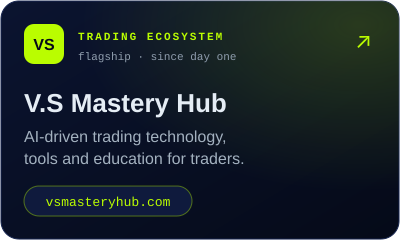
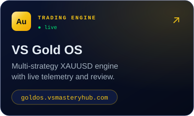
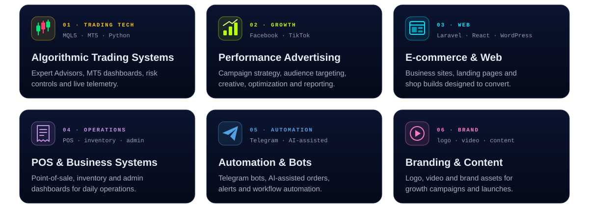
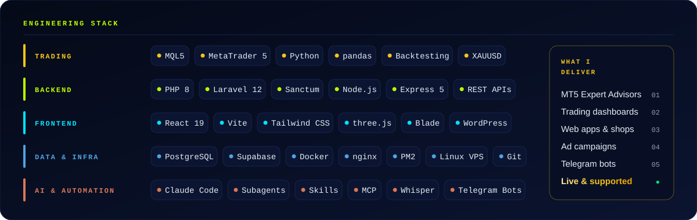
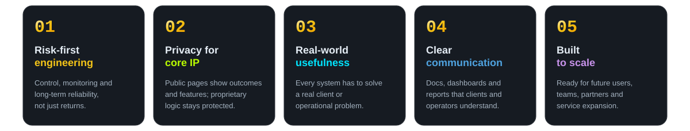

<!-- All visuals are self-hosted SVGs in /assets — no third-party stat widgets, so nothing breaks or hits a quota. -->

  

  
  
  

## 👋 About Me

I'm a **Cambodia-based systems developer and digital business operator** building at the intersection of **algorithmic trading** and **digital growth**. I design trading technology under the proprietary **VSConcept** framework at **V.S Mastery Hub**, and I run performance-marketing and web-product services through **Vincent Digital Marketing**. Everything I build is made to work in **real operations**, not just in demos.

  

## 🧩 Ventures & Products

  
  
  

## 🛠️ Services

  

## ⚙️ Engineering Stack

  

## 🌐 Selected Work

| Area | Public Summary | Link |
| --- | --- | --- |
| **VSConcept Trading Framework** | AI-driven trading technology, automation and execution tooling for XAUUSD and modern markets. | [vsmasteryhub.com](https://vsmasteryhub.com) |
| **VS Gold OS** | Gold trading platform with live performance views for traders and partners. | [goldos.vsmasteryhub.com](https://goldos.vsmasteryhub.com) |
| **Brand Growth Portfolio** | Ads, web and branding for retail and lifestyle brands, including beauty, fashion and watches. | [vincentchhuy.com](https://vincentchhuy.com) |
| **Private Trading R&D** | Risk-first EAs, on-chart dashboards and research workflows, developed privately. | Private R&D |
| **Business Automation** | Shops, POS systems, admin dashboards and Telegram bots delivered for client operations. | Client projects |

## 🧭 Working Principles

  

## 📩 Let's Connect

  
  
  
  

 

  

