<!-- All visuals are self-hosted SVGs in /assets — no third-party stat widgets, so nothing breaks or hits a quota. -->

  

  
  
  
  

 

> **I build gold-trading systems end to end** — from a raw idea, through backtesting, into a live Python engine, an API, an admin panel, a public web app and the MT5 Expert Advisor that executes the trade.
> I build all of it with **Claude Code** as my daily engineering partner, using my own skills, audit agents and memory, so a one-person team ships like a full studio.
> Alongside the trading work, I run **Vincent Digital**, which handles ads, e-commerce and business automation for real brands.

 

## ⚡ How I Build

  

## 🚀 What I'm Building

  
  
  

## 🧭 System Map

  

## 🟡 Three Ways to Trade Gold

Every source I study is scored for each of these three styles: research papers, trading videos, live data and competitor EAs.

  

## 🛠️ Stack

  

## 🧱 Engineering Rules I Ship By

| Rule | Why |
| --- | --- |
| **Fix the reported symptom, then stop** | Working production code is never rewritten just because an audit flagged it. Audit findings go to a backlog. |
| **One change at a time on live systems** | Each change gets its own commit, its own deploy and its own test, so any regression traces back to one cause. |
| **Production is never the test bed** | A dedicated test VPS and staging prove a build first. Live only takes proven builds. |
| **Tag only what passed a live test** | A `Stable-Release` tag means the build has traded real money, not just that it compiled. |
| **Features public, core logic private** | Product pages show what a system does. Strategy logic stays closed. |

 

  

