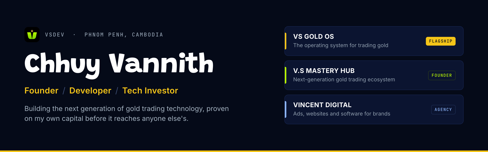

I'm **Chhuy Vannith** (VANNITH), founder of **V.S Mastery Hub** in Phnom Penh, Cambodia.

I work on markets from three sides. **As an investor**, I trade my own capital. **As a developer**, I write the systems, the MT5 Expert Advisors and the AI that read the gold market every day. **As a founder**, I turn what works into products other traders can use.

Everything I ship runs on my own accounts before it reaches anyone else's.

---

### Ventures

| | Venture | Role | What it is |
| :-: | --- | --- | --- |
| 🟡 | **[VS GOLD OS](https://goldos.vsmasteryhub.com)** | Creator | The operating system for trading gold. My flagship product. |
| 🟢 | **[V.S Mastery Hub](https://vsmasteryhub.com)** | Founder | A next-generation gold trading ecosystem, built in-house and powered by our own AI. |
| 🔵 | **[Vincent Digital](https://vincentchhuy.com)** | Founder | A digital agency for Facebook and TikTok ads, websites, custom software and Telegram bots. |

### Flagship: VS GOLD OS

> **Every force moving gold. Read in one place.**

VS GOLD OS watches one market and never stops. It weighs everything moving gold, including the dollar, rates, oil and geopolitical risk, and gives one plain answer with the reasoning attached.

- **Always on.** It reads gold 24/5, with no fatigue, no mood and no revenge trades.
- **More than fixed code.** An LLM analyst reviews every setup but never places a trade.
- **Knows when to stand aside.** Not trading is often the right call.
- **On the record.** Results are tracked in public, good and bad.

### The V.S Mastery Hub lineup

| Product | For |
| --- | --- |
| **GOLD OS Desk** | Traders who place their own trades: one verdict on gold with the reasoning, charts and news in one dashboard |
| **GOLD OS SignalMaster EA** | Traders who want the setups taken for them on their own MT5, with their own risk settings |
| **GOLD OS Straddle** | A breakout scalper EA for gold's fast moves |
| **VS TradeConnectorSuite** | Linking several MT5 accounts so they trade in sync across brokers |
| **Premium Indicators** | Invite-only TradingView scripts |
| **Education and Community** | A gold trading course from the basics up, plus an open Telegram community |

### How I build and invest

- **My own capital first.** A system goes to customers only after it has run on my accounts.
- **Risk before returns.** Every trade has a stop. No product promises profit.
- **In-house, end to end.** We own the engine, the AI, the EAs, the platform and the infrastructure.
- **One proven change at a time.** Live systems get small, tested updates, never big rewrites.

### Stack

| Area | Tools |
| --- | --- |
| AI | LLM agents, Claude Code, MCP, Whisper |
| Trading | MQL5, MetaTrader 5, Python, TradingView Pine Script |
| Product | React 19, Vite, Tailwind CSS, Laravel 12, Node.js |
| Infrastructure | PostgreSQL, Supabase, Docker, nginx, Linux VPS |

### Contact

For partnerships, investment or trading-technology projects, message me on Telegram: **[@ChhuyVannithDev](https://t.me/ChhuyVannithDev)**.

Trading carries a risk of loss. Past performance does not predict future results.
